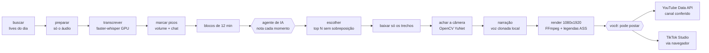

# Creator Automation Studio

**Da live de 4 horas ao Short publicado, rodando numa máquina local, com um agente de IA (Claude Code) fazendo a
parte editorial e Python + FFmpeg fazendo o resto.**

Duas automações que eu uso nos meus canais:

1. **Cortes de GTA 6 (canal de cortes):** encontra as lives do dia, escuta tudo localmente, escolhe os melhores
   momentos, monta o corte vertical com legenda palavra por palavra e narração com voz clonada.
2. **Postagem (todos os meus canais):** publica no YouTube o vídeo pronto, conferindo que está no canal certo.
   Meus três canais (cortes, animação e pessoal) usam a mesma postagem. Os vídeos de animação e do canal pessoal são
   produzidos à parte, a partir da minha narração, cada um no seu estilo; aqui eles só entram na hora de postar.

> *English summary:* a local-first pipeline that turns long GTA 6 livestreams into Shorts — it finds today's streams,
> transcribes them on the GPU, lets an LLM agent rank the moments, and renders 9:16 clips (facecam on top, gameplay
> below, word-level captions, cloned-voice narration with audio ducking). A separate publishing module uploads
> finished videos from any of my channels through the YouTube Data API, always checking it is the right channel,
> with a human approval gate before anything goes public.

---

## Como funciona



| Etapa | O que faz | Por quê assim |
|---|---|---|
| `buscar` | Procura vídeos longos publicados hoje, ordena por visualizações | Lives do dia são o que está em alta |
| `preparar` | Baixa **só o áudio** e transcreve com tempo por palavra | Uma live de 4 h vira algumas centenas de MB, não dezenas de GB |
| picos | Volume acima da mediana móvel (grito, susto) e chat do replay acelerando | Pistas baratas de onde algo aconteceu; o agente confirma pela fala |
| blocos | Transcrição em blocos de 12 min com as marcas `[ALTO +12dB]` e `[CHAT 3.1x]` | Cabe no contexto do modelo e mantém a leitura focada |
| agente | Dá nota de 0 a 100 a cada momento, escreve título-gancho, legenda do post e a narração | É a parte editorial, a única que precisa de julgamento |
| `cortar` | Baixa só os segundos escolhidos, acha a câmera, narra e renderiza | Rápido e sem baixar a live inteira |
| `postar` | Envia pela API do YouTube; confere o nome do canal antes de cada envio | Três canais na mesma máquina: nunca postar no canal errado |

### O corte
- **Layout sempre em tela cheia:** câmera do streamer na faixa de cima e o jogo até o fim da tela; sem câmera, o vídeo
  preenche a tela inteira. Nada de fundo borrado.
- **Câmera achada sozinha:** detecta rostos em 20 quadros, agrupa os centros numa grade e fica com o rosto que fica
  parado no mesmo lugar (a webcam); rosto que anda pela tela (personagem) é descartado.
- **Legenda palavra por palavra** (ASS/libass), com a palavra falada em destaque e "pop" no começo de cada grupo.
- **Narração** gerada localmente (VoiceStudio, voz clonada) e mixada com *sidechain ducking*: o áudio original abaixa
  sozinho enquanto a narração fala. Master em **−14 LUFS** (EBU R128).
- **Limite de 2:50** por corte (margem para o limite de 3 min do Shorts).
- Cada vídeo sai com um `.txt` com título, descrição, crédito com o link da fonte e hashtags.

### Decisões de projeto
- **Local-first:** transcrição, detecção de rosto, voz e render rodam na GPU da máquina (testado numa RTX 4060, 8 GB).
- **Pessoa no circuito:** nada é publicado sem o "pode postar" do dono do canal. O agente prepara; a pessoa decide.
- **Nenhum segredo no código:** credenciais OAuth, tokens e configuração das contas ficam em `CAS_HOME`, fora do repositório.
- **Retomável:** cada etapa grava o que produziu; rodar de novo continua de onde parou.

---

## Instalação

Requisitos: Python 3.10+, FFmpeg no PATH, GPU NVIDIA opcional (sem GPU, a transcrição roda na CPU).

```bash
pip install -r requirements.txt
python -m cas instalar        # confere tudo, baixa o detector de rosto e cria as pastas em CAS_HOME
```

`CAS_HOME` (padrão `~/creator-automation-studio`) guarda `config.json`, `contas.json`, `segredos/`, `trabalho/` e
`saida/`. Edite os arquivos criados a partir de `config/*.example.json`.

### Voz
O motor padrão é o VoiceStudio local (TTS com voz clonada) (servidor MCP em `127.0.0.1:3900`). Sem ele, o pipeline usa
o edge-tts como **rascunho** e marca o arquivo como `(RASCUNHO)` (o edge-tts não é para uso comercial).

### YouTube
1. Crie um projeto no Google Cloud, ative a **YouTube Data API v3** e crie um cliente OAuth do tipo **App para computador**.
2. Salve o JSON em `CAS_HOME/segredos/client_secret.json`.
3. Publique o app (precisa de página inicial e política de privacidade) para a autorização não vencer em 7 dias.
4. `python -m cas autorizar --conta cortes` e autorize com a conta do canal.

Projetos não verificados pelo Google enviam como **privado**: o vídeo é revisado e tornado público no YouTube Studio.

---

## Uso

```bash
python -m cas buscar                                   # lives de GTA 6 de hoje
python -m cas preparar "https://www.youtube.com/watch?v=..."
# o agente lê trabalho/<fonte>/blocos/bloco_NN.txt e escreve trabalho/<fonte>/momentos/bloco_NN.json
python -m cas escolher <fonte> --manter 3
python -m cas cortar <fonte>
python -m cas postar --conta cortes --pasta "saida/<fonte>"
```

Para vídeos que já estão no disco, descreva os cortes num `cortes.json` e rode `python -m cas cortar-arquivo cortes.json`.

### Formato de um momento (`momentos/bloco_NN.json`)
```json
[{
  "inicio": "01:12:03", "fim": "01:12:41", "nota": 88, "tipo": "primeira reação",
  "titulo": "ELE NÃO ACREDITOU NO TAMANHO DO MAPA",
  "porque": "grita ao ver o mapa inteiro; fecha sozinho sem precisar de contexto",
  "post": "O tamanho do mapa do GTA 6 deixou ele sem palavras 😳 #gta6 #gtavi",
  "narracao": [{"t": 0.2, "texto": "Ele achou que já tinha visto tudo do mapa..."}]
}]
```

### Com o Claude Code
A pasta `skill/creator-automation-studio/` é uma skill do Claude Code com as regras editoriais (o que vale um corte,
o que descartar, como dar nota, como escrever o gancho). Copie para `~/.claude/skills/` e peça
"corta essa live: LINK".

---

## Estrutura

```
cas/
  __main__.py   linha de comando (python -m cas …)
  config.py     pastas, configuração, carregamento do Whisper (GPU → CPU)
  fonte.py      yt-dlp: metadados, só o áudio, só o trecho, chat do replay, busca do dia
  ouvir.py      transcrição, picos de volume e de chat, blocos para leitura
  escolher.py   ranking dos momentos sem sobreposição
  camera.py     detecção da webcam do streamer (OpenCV YuNet + agrupamento)
  voz.py        cliente MCP do VoiceStudio + reserva edge-tts + tempo por palavra
  render.py     layout 9:16, legendas ASS, ducking, loudnorm, encoder NVENC/x264
  postar.py     YouTube Data API: OAuth por conta, conferência do canal, envio retomável
config/         exemplos de config.json e contas.json
skill/          skill do Claude Code (regras editoriais)
```

## Créditos
[FFmpeg](https://ffmpeg.org), [yt-dlp](https://github.com/yt-dlp/yt-dlp),
[faster-whisper](https://github.com/SYSTRAN/faster-whisper),
[OpenCV YuNet](https://github.com/opencv/opencv_zoo/tree/main/models/face_detection_yunet) (MIT),
[YouTube Data API](https://developers.google.com/youtube/v3).
A ideia de dividir a transcrição em blocos com marcas de volume/chat para um agente dar nota foi inspirada no
projeto [skill-clips](https://github.com/davixavier-coder/skill-clips); o código aqui é próprio.

**Respeite os criadores:** corte só de quem libera cortes e mantenha o crédito com o link da fonte (o `.txt` de cada
corte já traz).

Licença: MIT.
